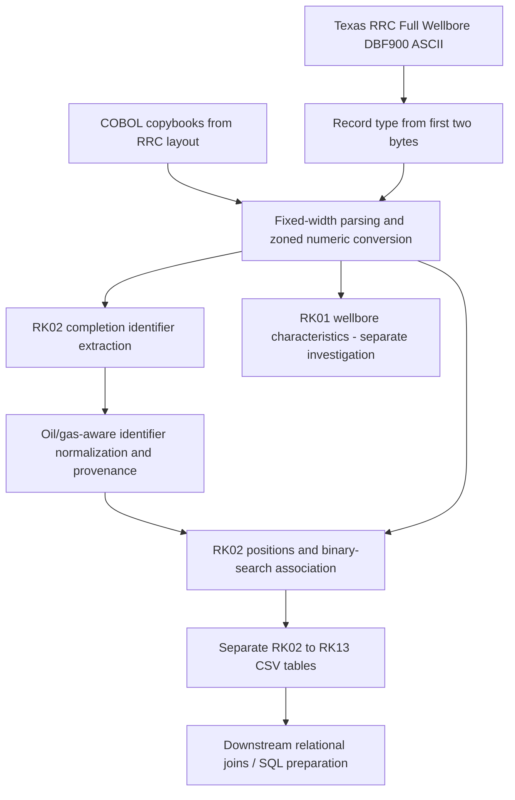

# Workflow



## Historical versus new implementation

The archived August 2, 2025 code used RK02 intervals and `bisect_right`. The `src/` modules are a **new refactor** that adds explicit oil/gas selection and guards against assigning a preceding completion across an RK01 boundary. RK01 is used as a boundary marker only, **not** as the primary integration identifier.

## Running locally

Install Python and the compatible third-party `copybook` parser used by the historical scripts. Provide the source file and reviewed `.cpy` layouts locally:

```bash
python -m src.root_key_extraction --source /path/to/dbf900.txt --copybooks /path/to/copybooks --output ./output
python -m unittest discover -s tests -v
```

No original DBF900 records are distributed. The synthetic example under `examples/` demonstrates record order and is **not** a valid fixed-width DBF900 source. Full parser compatibility with the original copybooks and real data remains unverified.
